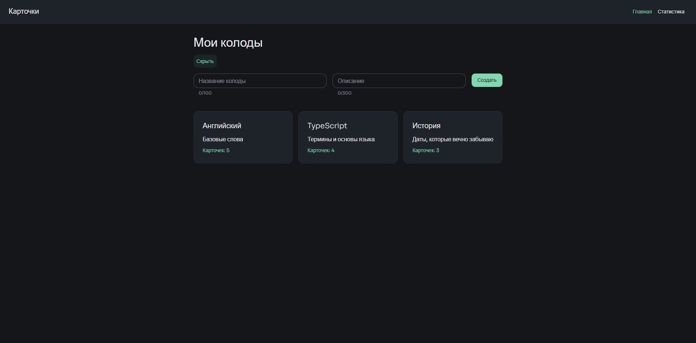
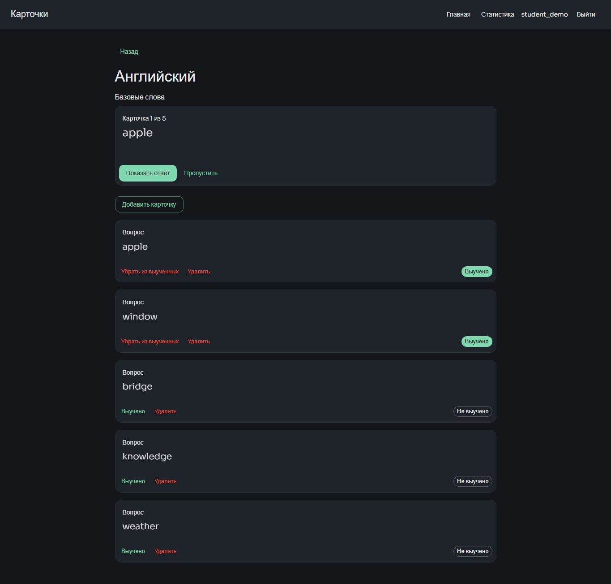
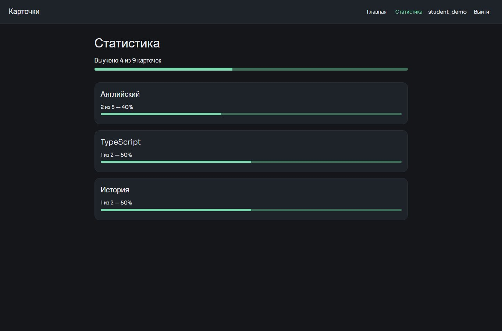
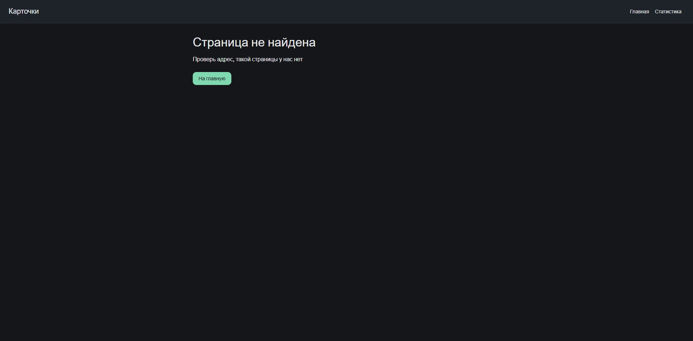

# Карточки

Веб-приложение для запоминания слов и терминов по карточкам. У карточки две стороны: вопрос и ответ. Карточки собираются в колоды, колоду можно проходить в режиме тренировки.

## Сценарии

- Посмотреть свои колоды
- Создать колоду
- Открыть колоду и посмотреть карточки в ней
- Добавить карточку
- Пройти колоду: смотрю вопрос, вспоминаю, показываю ответ, иду дальше
- Отметить карточку выученной
- Посмотреть статистику по колодам

## Экраны

| Адрес | Экран | Что на нём |
| --- | --- | --- |
| `/` | Главная | список колод, у каждой название, описание и число карточек |
| `/decks/:id` | Колода | тренажёр, форма добавления карточки и список карточек |
| `/stats` | Статистика | общий прогресс и прогресс по каждой колоде |
| любой другой | 404 | сообщение и кнопка на главную |

## Модель данных

Две таблицы со связью один-ко-многим: в колоде много карточек, каждая карточка лежит в одной колоде.

`decks` — колоды

| Поле | Тип | |
| --- | --- | --- |
| id | integer | первичный ключ |
| title | varchar(100) | название |
| description | varchar(300) | описание, по умолчанию пустое |

`cards` — карточки

| Поле | Тип | |
| --- | --- | --- |
| id | integer | первичный ключ |
| question | varchar(500) | вопрос |
| answer | varchar(500) | ответ |
| learned | boolean | выучена или нет, по умолчанию false |
| deck_id | integer | внешний ключ на `decks.id` |

При удалении колоды удаляются и её карточки (`ON DELETE CASCADE`).

## Стек

React 19 + TypeScript, Vite, React Router, MUI.

## Запуск

```
cd frontend
npm install
npm run dev
```

Откроется на http://localhost:5173

Пока frontend не подключён к backend, колоды грузятся из моков с задержкой. Чтобы посмотреть другие состояния, добавь к адресу:

- `?fail` — ошибка загрузки;
- `?empty` — пустой список колод.

Сборка:

```
npm run build
```

## Структура

```
frontend/          React + TypeScript
backend/           FastAPI + PostgreSQL
docs/screenshots/  скриншоты экранов
```

### Frontend

Код разложен по слоям упрощённого [Feature-Sliced Design](https://feature-sliced.design/). Полное FSD не соблюдается: нет слоя `widgets`, у сегментов только `ui`, `model` и `api`.

```
src/
  app/           настройка приложения
    App.tsx        роуты
    Layout.tsx     шапка и навигация
    providers.tsx  тема MUI и роутер
    theme.ts       тёмная тема
  pages/         страницы, собирают фичи и сущности
    home/          список колод
    deck/          колода: тренажёр, форма, карточки
    stats/         статистика
    not-found/     404
  features/      действия пользователя
    create-deck/   форма создания колоды
    add-card/      форма добавления карточки и её валидация
    train-deck/    тренажёр по колоде
    toggle-learned/ отметка «выучено»
    remove-card/   удаление карточки
  entities/      сущности предметной области
    card/          тип Card и отображение карточки
    deck/          тип Deck, хранилище колод (context + useReducer), фейковый api на моках, список колод
  shared/        общий код без привязки к предметной области
    ui/            EmptyState, Loader, ErrorMessage, NotFoundMessage
    lib/           percent, delay
    api/           тип статуса загрузки
  main.tsx       точка входа
```

Правила:

- слой импортирует только из слоёв ниже: `app → pages → features → entities → shared`;
- каждый модуль отдаёт наружу только то, что есть в его `index.ts`, импорты снаружи идут через него;
- между слоями импорты через алиас `@/` (`@/entities/deck`), внутри модуля относительные.

## Скриншоты





