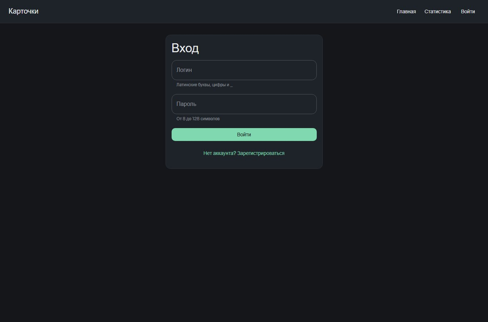
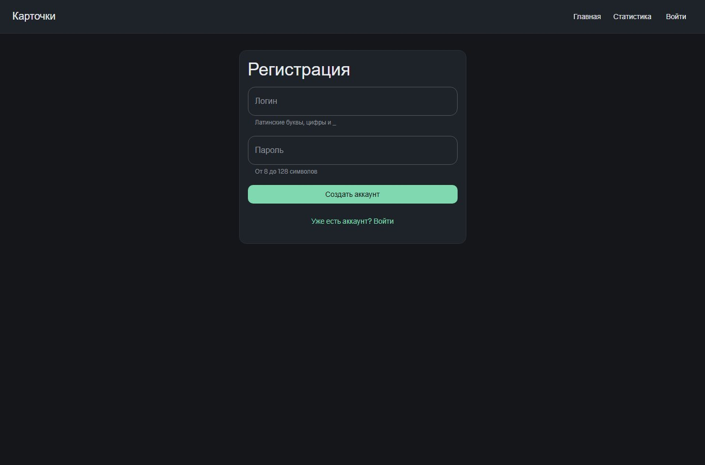
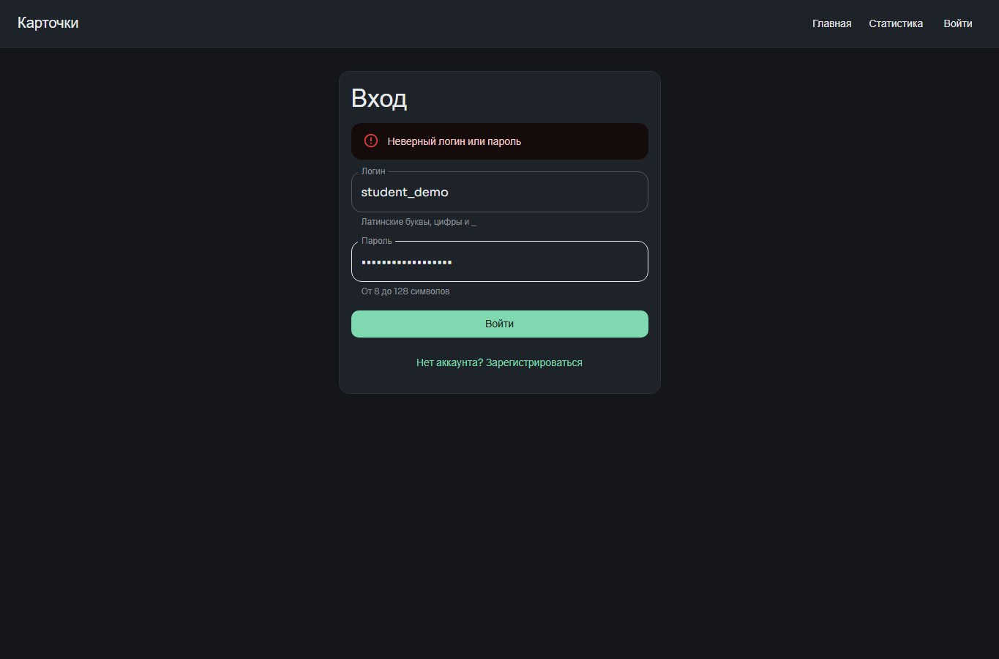
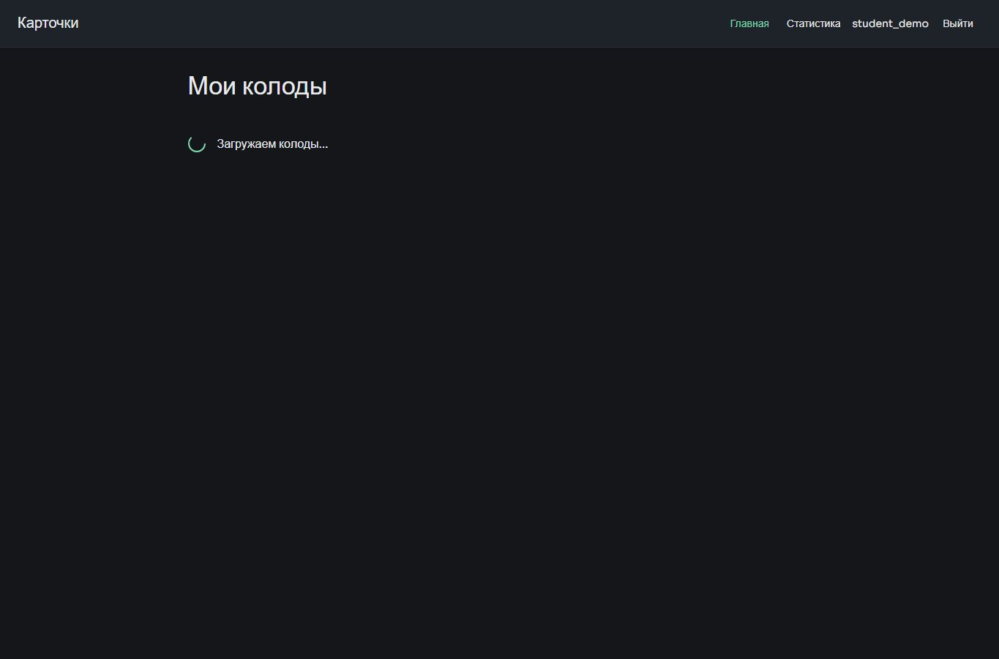
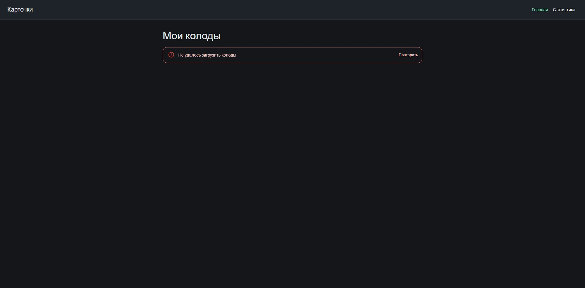
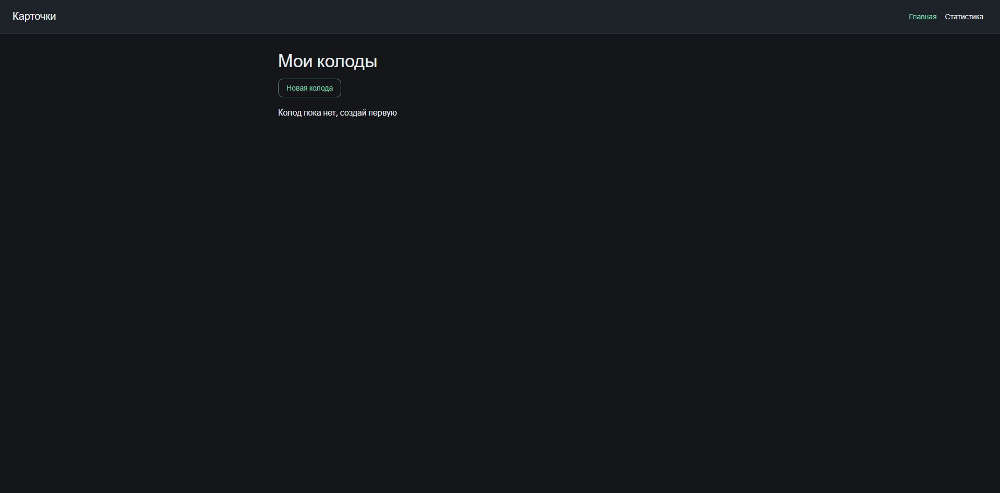
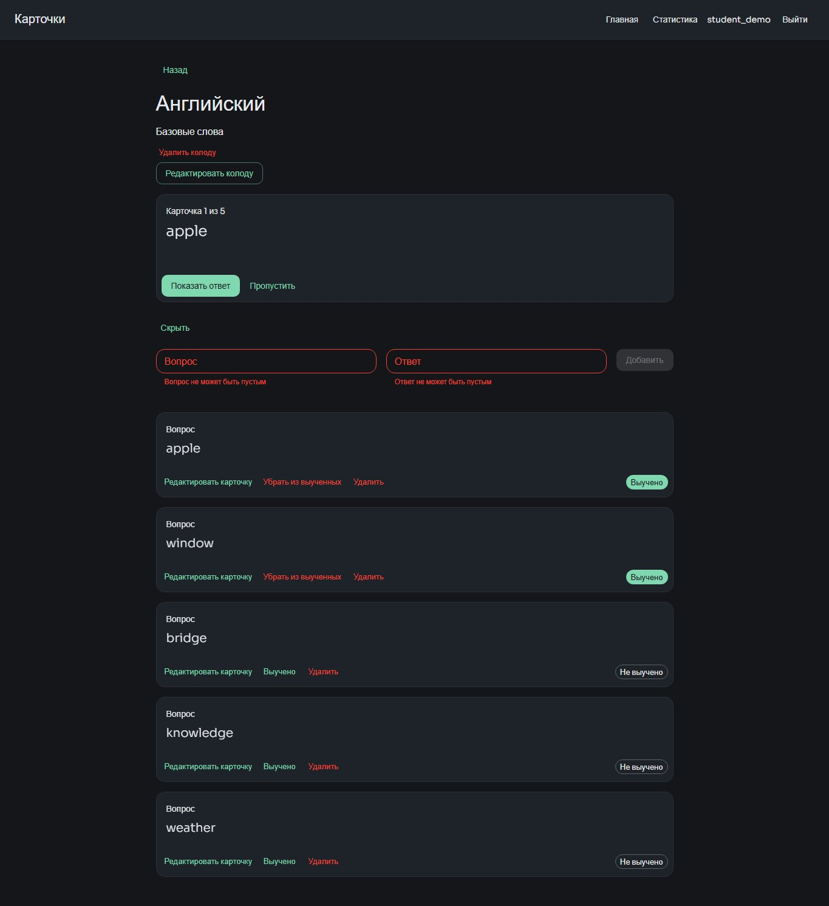

# Карточки

Веб-приложение для запоминания слов и терминов по карточкам. У карточки две стороны: вопрос и ответ. Карточки собираются в колоды, колоду можно проходить в режиме тренировки.

## Сценарии

- Посмотреть свои колоды
- Создать колоду
- Открыть колоду и посмотреть карточки в ней
- Добавить карточку
- Удалить карточку
- Перевернуть карточку, чтобы посмотреть ответ
- Пройти колоду: смотрю вопрос, вспоминаю, показываю ответ, иду дальше
- Отметить карточку выученной
- Посмотреть статистику по колодам
- Зарегистрироваться, войти в аккаунт и выйти из текущей сессии

## Экраны

| Адрес | Экран | Что на нём |
| --- | --- | --- |
| `/` | Главная | форма новой колоды и список колод, у каждой название, описание и число карточек |
| `/decks/:id` | Колода | тренажёр, форма добавления карточки и список карточек |
| `/stats` | Статистика | общий прогресс и прогресс по каждой колоде |
| `/login` | Вход | логин, пароль и переход к регистрации |
| `/register` | Регистрация | создание аккаунта и автоматический вход |
| любой другой | 404 | сообщение и кнопка на главную |

## Интерфейс

Что сделано в ЛР3 поверх экранов из ЛР1.

**Состояние.** Колоды хранятся в общем хранилище (`DecksProvider`: React context + `useReducer`). Добавленные и удалённые карточки, отметки «выучено» и новые колоды сразу видны на всех экранах, например в статистике. Данные живут до перезагрузки страницы или выхода из аккаунта, сохранение появится вместе с подключением API в ЛР5. При смене пользователя хранилище сбрасывается.

**Загрузка, ошибка, пустые данные.** Колоды загружаются асинхронно через `fetchDecks()` (пока моки с задержкой 600 мс). На каждом экране с данными есть все состояния:

| Состояние | Что видно |
| --- | --- |
| загрузка | спиннер с подписью |
| ошибка (`?fail`) | сообщение и кнопка «Повторить» |
| нет данных (`?empty`) | подсказка, что делать дальше |
| колода не найдена | сообщение и кнопка на главную |

**Валидация форм.** Проверка на клиенте, лимиты совпадают с backend:

| Форма | Поле | Правила |
| --- | --- | --- |
| Новая колода | название | обязательно, до 100 символов, без повторов |
| | описание | до 300 символов |
| Новая карточка | вопрос | обязательно, до 500 символов, без повторов в колоде |
| | ответ | обязательно, до 500 символов |

Ошибка показывается под полем после того, как поле тронули или нажали кнопку отправки, до этого под полем счётчик символов. После неудачной отправки кнопка неактивна, пока ошибки не исправлены. Пробелы по краям обрезаются.

**Анимации.**

- карточка переворачивается в 3D при клике и в тренажёре по кнопке «Показать ответ»;
- формы раскрываются и скрываются по кнопкам «Новая колода» и «Добавить карточку»;
- новые карточки плавно появляются, удалённые сворачиваются;
- колоды на главной появляются по очереди;
- при переходе между страницами содержимое плавно проявляется.

Если в системе включено уменьшение движения, переворот карточки идёт без анимации.

## Модель данных

Пользователь владеет колодами, в каждой колоде много карточек. Сессии входа хранятся отдельно.

`users` — пользователи: `id` (первичный ключ), уникальный `username` до 50 символов, `password_hash` (Argon2id).

`refresh_sessions` — сессии: `id`, уникальный `token_hash` (SHA-256), `user_id` (внешний ключ на `users.id`), `expires_at` (срок действия), `revoked` (отозвана ли сессия). Исходный refresh token в БД не хранится.

`decks` — колоды

| Поле | Тип | |
| --- | --- | --- |
| id | integer | первичный ключ |
| title | varchar(100) | название |
| description | varchar(300) | описание, по умолчанию пустое |
| owner_id | integer | обязательный внешний ключ на `users.id` |

`cards` — карточки

| Поле | Тип | |
| --- | --- | --- |
| id | integer | первичный ключ |
| question | varchar(500) | вопрос |
| answer | varchar(500) | ответ |
| learned | boolean | выучена или нет, по умолчанию false |
| deck_id | integer | внешний ключ на `decks.id` |

При удалении колоды удаляются и её карточки (`ON DELETE CASCADE`).

## Стек

Frontend: React 19 + TypeScript, Vite, React Router, MUI.

Backend: Python 3.10+, FastAPI, PostgreSQL 17, SQLAlchemy, Pydantic Settings, PyJWT, pwdlib + Argon2.

## Запуск

### Backend и БД

Нужны Python, Node.js с npm и запущенный Docker Desktop. Команды ниже — для PowerShell из корня проекта.

```powershell
cd backend
python -m venv .venv
.\.venv\Scripts\python.exe -m pip install -r requirements.txt
Copy-Item .env.example .env
```

В `.env` задай свой `POSTGRES_PASSWORD` и случайный `JWT_SECRET` длиной не менее 32 символов. Для генерации секрета:

```powershell
.\.venv\Scripts\python.exe -c "import secrets; print(secrets.token_hex(32))"
```

Остальные настройки из примера подходят для локального запуска: БД `flashcards`, пользователь `flashcards`, адрес `localhost:5433`. `.env` не попадает в Git.

```powershell
docker compose up -d
docker compose exec db pg_isready -U flashcards -d flashcards
.\.venv\Scripts\python.exe -m app.db.init_db
.\.venv\Scripts\python.exe -m uvicorn app.main:app --reload
```

Дождись готовности БД перед созданием таблиц. API: http://localhost:8000, Swagger: http://localhost:8000/docs. Для остановки БД: `docker compose stop`.

Если БД уже использовалась в ЛР2, `init_db` создаст новые таблицы, но не изменит старую `decks`. После этого зарегистрируй владельца старых колод через `POST /auth/register` в Swagger и выполни из `backend`:

```powershell
.\.venv\Scripts\python.exe -m app.db.upgrade_auth --owner ВАШ_ЛОГИН
```

Команда добавляет `owner_id`, назначает указанного пользователя владельцем старых колод и сохраняет карточки. Повторный запуск допустим. На новой пустой БД достаточно `init_db`.

### Frontend

В другом терминале из корня проекта:

```
cd frontend
npm install
npm run dev
```

Откроется на http://localhost:5173

Регистрация, вход, восстановление сессии и выход работают с настоящим backend. Колоды и статистика пока используют моки из ЛР3; подключение CRUD к API относится к ЛР5. После входа можно посмотреть состояния колод, добавив к адресу:

- `?fail` — ошибка загрузки;
- `?empty` — пустой список колод.

Сборка:

```
npm run build
```

При разработке Vite перенаправляет `/api/*` на `http://127.0.0.1:8000/*`. Открывай приложение через Vite, чтобы cookie и запросы использовали один адрес. В production нужно такое же перенаправление `/api` на backend; сама статическая сборка прокси не запускает.

## Аутентификация и авторизация — ЛР4

Логин: 3–50 латинских букв, цифр или `_`, с учётом регистра. Пароль: 8–128 символов; пробелы в пароле не обрезаются. На клиенте есть проверка полей, на сервере — схемы Pydantic. Дубликат логина возвращает 409, неправильный пароль — 401.

| Метод и адрес | Назначение | Доступ |
| --- | --- | --- |
| `POST /auth/register` | регистрация, JSON с `username` и `password` | публичный |
| `POST /auth/login` | вход с теми же полями, access в JSON и refresh в cookie | публичный |
| `POST /auth/refresh` | новый access по refresh cookie | действующая сессия |
| `POST /auth/logout` | отзыв текущего refresh и удаление cookie | текущая cookie, access не требуется |
| `GET /auth/me` | текущий пользователь без пароля и хеша | Bearer access token |
| `/decks`, `/decks/{id}`, `/decks/{id}/cards`, `/cards/{id}` | CRUD колод и карточек | только владелец |

Access token — JWT с подписью HS256, сроком действия 15 минут и идентификатором пользователя в `sub`. Refresh — случайная строка со сроком 7 дней, хранится в HttpOnly cookie с `SameSite=Lax`. Сроки настраиваются через `ACCESS_TOKEN_MINUTES` и `REFRESH_TOKEN_DAYS`. Для HTTPS укажи `COOKIE_SECURE=true`.

Access хранится только в памяти frontend. При перезагрузке приложение получает новый access через refresh, затем запрашивает `/auth/me`. При 401 защищённый запрос обновляет access и повторяется один раз. Недействительный refresh закрывает приватные страницы; ошибка сети показывает кнопку повтора.

Выход отзывает refresh только текущей сессии, очищает пользователя, access и локальные колоды. Другие сессии продолжают работать. Уже выданный access остаётся действительным до истечения 15 минут. Если сервер недоступен, интерфейс предлагает повторить выход, поскольку отзыв ещё не подтверждён.

Без access приватный API возвращает 401. Колоды в списке фильтруются по владельцу. Чужая колода или карточка возвращает 404 при просмотре, изменении и удалении. `/health`, страницы входа и регистрации доступны без входа.

## Проверка

Тесты backend из папки `backend`:

```powershell
.\.venv\Scripts\python.exe -m pip install -r requirements-dev.txt
.\.venv\Scripts\python.exe -m pytest -q
```

По умолчанию используется временная SQLite для проверки логики; тест перехода схемы пропускается. Чтобы проверить PostgreSQL, задай `TEST_DATABASE_URL` с адресом **отдельной тестовой БД**, имя которой заканчивается на `_test`, и выполни ту же команду. Тесты создают и удаляют таблицы в этой БД.

Проверяются хеширование, регистрация, дубликаты, вход, текущий пользователь, срок JWT, поддельный и истёкший access, обновление и отзыв refresh, независимость сессий, права двух пользователей и сохранность старых данных при обновлении схемы PostgreSQL.

Проверка браузером: запусти backend и frontend по инструкции, затем из корня проекта:

```powershell
backend\.venv\Scripts\python.exe -m playwright install chromium
backend\.venv\Scripts\python.exe -X utf8 frontend\tests\auth_browser.py
```

Скрипт создаёт два тестовых аккаунта и проверяет формы, закрытые маршруты, перезагрузку, обновление access, выход, смену аккаунта и ошибки сети. При изменении адреса frontend нужно обновить URL в скрипте.

## Структура

```
frontend/          React + TypeScript
backend/           FastAPI + PostgreSQL
docs/screenshots/  скриншоты экранов
```

### Frontend

Код разложен по слоям упрощённого [Feature-Sliced Design](https://feature-sliced.design/). Полное FSD не соблюдается: нет слоя `widgets`, у сегментов только `ui`, `model` и `api`.

```
src/
  app/           настройка приложения
    App.tsx        роуты
    Layout.tsx     шапка, навигация, анимация смены страниц
    providers.tsx  тема MUI, роутер, хранилище колод
    theme.ts       тёмная тема
  pages/         страницы, собирают фичи и сущности
    home/          список колод
    deck/          колода: тренажёр, форма, карточки
    stats/         статистика
    not-found/     404
    login/         вход
    register/      регистрация
  features/      действия пользователя
    create-deck/   форма создания колоды и её валидация
    add-card/      форма добавления карточки и её валидация
    train-deck/    тренажёр по колоде
    toggle-learned/ отметка «выучено»
    remove-card/   удаление карточки
    auth/          форма входа/регистрации и защита маршрутов
  entities/      сущности предметной области
    card/          тип Card и отображение карточки
    deck/          тип Deck, хранилище колод (context + useReducer), фейковый api на моках, список колод
    user/          текущий пользователь, вход, выход и восстановление сессии
  shared/        общий код без привязки к предметной области
    ui/            EmptyState, Loader, ErrorMessage, NotFoundMessage,
                   FlipCard, AnimatedItem, ToggleSection
    lib/           percent, delay
    api/           HTTP-клиент, обновление access и тип статуса загрузки
  main.tsx       точка входа
```

Правила:

- слой импортирует только из слоёв ниже: `app → pages → features → entities → shared`;
- каждый модуль отдаёт наружу только то, что есть в его `index.ts`, импорты снаружи идут через него;
- между слоями импорты через алиас `@/` (`@/entities/deck`), внутри модуля относительные.

## Скриншоты






Состояния и формы:






В ЛР4 добавлены формы входа и регистрации, имя пользователя и кнопка выхода в шапке. Скриншоты основных экранов обновлены под эту навигацию; экраны колод остаются на демонстрационных данных до ЛР5.
